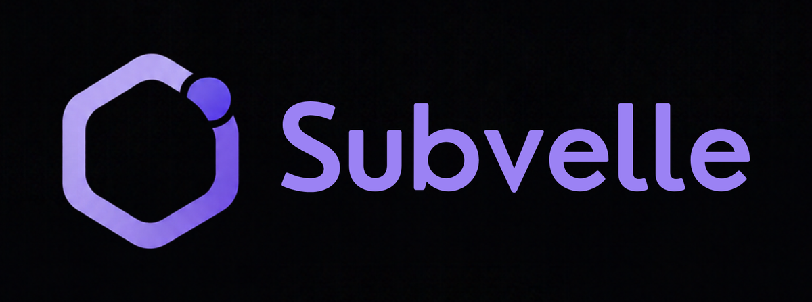

<p align="center"></p>

# Subvelle

A private, local-first subscription tracker for your phone. Know what you pay, what renews next, and where your money goes, without accounts, ads, tracking, bank access, or paid APIs.

Subvelle is one app with a native version for each phone platform. Both versions share the same financial rules and the same backup format, so you can move your subscriptions from one phone to another.

## Features

- **Home**: one screen with four folders, Overview, Subscriptions, Analytics and Settings, each with a live preview. A folder pops open over a blurred background (on Android, blur needs Android 12 or later; older versions dim it); close it with ✕, a tap outside, a swipe down, or Back on Android.
- **Service icons**: each service is shown with its logo on its brand colour, or a brand-coloured monogram when no logo is available. Logos are trademarks of their owners, shown only to identify each service; the artwork comes from [Simple Icons](https://simpleicons.org) (CC0). `Tools/GenerateBrandCatalog.py` regenerates the catalog.
- **Overview**: normalized monthly, annual and weekly cost, active plans, a countdown to the next payment, upcoming renewals, and your largest commitments.
- **Subscriptions**: 192 familiar services in 13 categories, or create your own. No prices are assumed. Search, filter by status and category, and sort by renewal, amount or name. Pause, cancel, archive, restore, or delete with confirmation.
- **Flexible schedules**: weekly, every two weeks, monthly, quarterly, every six months, annually, or any custom interval of days, weeks, months or years, plus trials, end dates and notes.
- **Analytics**: interactive spending chart by month or by day, the normalized monthly average, cost by category, by subscription and by billing currency, and a full payment calendar.
- **Currencies**: report in any currency (CAD by default). Exact decimal math, with each amount converted before totals are added. Exchange rates come from Frankfurter's central-bank reference rates and are cached for offline use; missing rates are flagged, never guessed.
- **Reminders**: local notifications 1, 3, 7 or 14 days before a renewal, around 9 AM local time.
- **Backups**: export and import JSON, plus automatic backup after every change to a folder you choose, for example a cloud-drive folder. You can also open a backup straight from Files or another app: **Share → Subvelle** on iPhone, **Open with** or **Share → Subvelle** on Android. Backups from either version import into the other.
- **About & updates**: Settings shows the installed version, links to this GitHub project, and has a **Check for updates** button that tells you when a newer release is available, with a link to download it.
- **Accessible**: dark or system appearance, dynamic text sizes, screen-reader labels, and reduced-motion support (on iPhone, Reduce Motion turns the folder pop-out into a fade).

## Download

Every release is on the [Releases page](../../releases). Pick the file for your phone:

| Your phone | File | How to install |
|---|---|---|
| iPhone (iOS 26 or later) | `Subvelle-<version>-<build>.ipa` | Import it into [SideStore](https://sidestore.io), which signs and installs it. |
| Android (8.0 or later) | `Subvelle-<version>-<build>.apk` | Open it on your phone and allow installs from your browser or file manager when asked. |

Each file has a `.sha256` checksum next to it. Updates install over the previous version and keep your data.

## Privacy

- Subscriptions are stored only on your phone.
- Network requests: public exchange rates and, only when you tap **Check for updates**, GitHub's public list of releases. Your subscriptions are never sent.
- Automatic backups are written only to the folder you choose.
- Your phone's own device backup (iCloud Backup or Google backup) may include the app's data, depending on your settings.

Backups are readable JSON files containing financial data, so store and share them carefully.

## Moving between phones

1. On the old phone: **Settings → Export backup** (or use the latest automatic backup file, `Subvelle Backup.json`).
2. Copy the file to the new phone, for example through a cloud drive or by email to yourself.
3. On the new phone: **Settings → Import backup**, or open the file from Files or another app and choose **Subvelle** in the share menu. Subvelle asks before importing: subscriptions with matching IDs are replaced; others are kept.

Version 1.1.0 named its automatic backups `Subspace Backup.json`. Newer versions write `Subvelle Backup.json` and leave the older files untouched; both import the same way.

Both versions write exactly the same format: `schemaVersion`, `exportedAt` and the list of subscriptions, with dates as seconds since 2001-01-01, exact decimal amounts, and identical field names. The Android test suite reads a backup produced by the iPhone code, and an Android-written backup has been validated by the iPhone code.

## Financial rules (both versions)

- `annual = amount × periods per year`, `monthly = annual ÷ 12`, `weekly = annual × 7 ÷ 365.2425`. Day and week plans use the mean Gregorian year (365.2425 days); month and year plans use 12 months.
- Each amount is converted to the reporting currency **before** totals are added. Unsupported currencies are excluded from converted totals and flagged.
- An annual $120 plan adds $10 to the normalized monthly cost but appears as one $120 charge in its renewal month. Normalized figures describe your current commitment, not a cash-flow total.
- Schedules are anchored to the renewal date you enter. Month-end dates are clamped without drifting: January 31 → February 28/29 → March 31. February 29 annual plans return to February 29 in leap years.
- The end date includes that day's charge. A trial's end bounds the first paid charge.
- Paused, canceled, archived and ended plans are excluded from averages, forecasts and reminders.
- There is no bank ledger: past chart bars are estimates rebuilt from your current schedules and cached rates, and they are labeled that way.

## Repository layout

Some code folders and modules still use the original internal name `Subspace`. It never appears in the apps, and keeping it avoids breaking builds and app IDs.

| Path | What it is |
|---|---|
| `Subspace/` | iPhone app (SwiftUI, Swift Charts, SwiftData). `Subspace/Core` is the `SubspaceCore` Swift package: models, schedules, currency, validation and presets. |
| `Tests/` | iPhone tests: core logic (also runs on Linux), storage, and simulator UI tests. |
| `Package.swift`, `project.yml` | Swift package and the XcodeGen project definition. |
| `android/` | Android app (Kotlin, Jetpack Compose, Material 3): a port of the same core logic with JVM unit tests and emulator UI tests. |
| `Subspace/Core/BrandCatalog.swift`, `Subspace/Resources/Assets.xcassets/Brands/` | iPhone service catalog and logos (generated). |
| `android/app/src/main/java/app/subspace/ui/BrandCatalog.kt`, `android/app/src/main/res/drawable/brand_*.xml` | Android service catalog and logos (generated, same data). |
| `Tools/` | `GenerateBrandCatalog.py` (services, brand colours and logos for both apps), `GenerateAppIcon.py` (the Subvelle mark: iPhone app icon, Android adaptive and themed icons, in-app logo), and the screenshot contact-sheet renderer used by CI. |
| `docs/` | README images, including the Subvelle logo. |
| `.github/workflows/` | CI for both builds and publishing. |

## Building

No Mac is needed: both apps build and test on GitHub Actions. To start a build manually, open **Actions**, pick the workflow and choose **Run workflow**.

| Workflow | Runs on | What it does |
|---|---|---|
| **iPhone · build, test and IPA** (`build.yml`) | macOS | Generates the Xcode project, runs core tests, storage and import tests, and simulator UI tests (opening and closing every folder, adding a subscription, large text, landscape), then builds an unsigned IPA. |
| **Android · build, test and APK** (`android.yml`) | Linux | Runs unit tests and lint, builds an optimized and shrunk release APK signed with the project key, and runs emulator UI tests: folders (✕, Back and outside tap), adding a subscription, opening a backup from another app, and scrolling 300 subscriptions. |
| **Publish verified iPhone build** (`publish.yml`) | Linux | Attaches an IPA from a successful build to a release, after checking its version, identifier and architecture. |

**Releases:** pushing a tag such as `v1.2.0` builds both apps with that version. The iPhone workflow creates the release, and the Android workflow attaches its APK once the release exists. A manual Android run with `release_tag` set attaches the APK to an existing release.

**Android signing:** release APKs are signed with a key stored in four repository secrets: `ANDROID_KEYSTORE_BASE64`, `ANDROID_KEYSTORE_PASSWORD`, `ANDROID_KEY_ALIAS` and `ANDROID_KEY_PASSWORD`. Keep a private backup of the key file and password: every future update must be signed with the same key. Never commit key files (`.gitignore` blocks `*.jks` and `*.keystore`).

### Local development

iPhone (requires a Mac with Xcode 26+):

```sh
brew install xcodegen
xcodegen generate
open Subspace.xcodeproj
swift test
```

Android (any OS with JDK 17 and the Android SDK):

```sh
cd android
./gradlew testDebugUnitTest lintRelease assembleRelease
```

The core Swift package also builds and tests on Linux with Swift 6: `swift test`.

### Service catalog and logos

Both apps use one generated catalog: the service list, each service's brand colour, and its logo where one is available. To add a service or update logos, edit the lists at the top of `Tools/GenerateBrandCatalog.py`, then run:

```sh
npm pack simple-icons && mkdir -p simple-icons && tar -xzf simple-icons-*.tgz -C simple-icons
python3 Tools/GenerateBrandCatalog.py simple-icons/package .
```

It rewrites the presets, catalogs and logo files for both apps, and stops if a service has neither a logo nor a brand colour. Some brands have asked Simple Icons to remove their logos; those get a monogram in their brand colour, and no logo is taken from elsewhere.

### Identifiers

| | iPhone | Android |
|---|---|---|
| App ID | `app.subspace.ios` (`project.yml`) | `app.subspace.android` (`android/app/build.gradle.kts`) |
| Minimum OS | iOS 26 | Android 8.0 (API 26), targets API 36 |

Changing an app ID creates a separate app with separate data, so export a backup first.

## Reliability

- **Saving:** each version saves atomically and never deletes or recreates stored data that fails to load; a load failure is reported and the stored bytes are kept.
- **Imports:** a file picked on iPhone is copied into the app first (downloaded from iCloud if needed). The whole file is validated before anything changes, and Subvelle asks before merging. Unsupported versions, duplicate IDs, invalid records, more than 10,000 records, and files over 20 MB are rejected.
- **Automatic backups:** writes are atomic or coordinated, a short burst of edits produces one backup, and a backup is retried at launch after a failure or when the last one is a day old. Fourteen daily copies are kept, and other files in the folder are never touched.
- **Reminders:** on iPhone, the earliest 60 reminders in a rolling two-year window are queued and refreshed on launch and after edits. On Android, a daily background job posts that day's reminders, survives reboots, and never posts the same day twice. Delivery always depends on the phone's notification, Focus and battery settings.

See [`VALIDATION.md`](VALIDATION.md) for what has been tested and what still needs checking on real phones.
